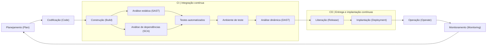

# GitHub Actions SAST Template

Modelo mínimo de GitHub Actions para executar análise estática de código com o Semgrep.

## Ciclo de desenvolvimento com DevSecOps

### Representação simplificada

O diagrama mostra um fluxo possível de desenvolvimento com práticas de DevSecOps. As etapas e sua organização variam entre equipes. Na CI, o código é integrado, construído e verificado. O DAST pressupõe uma aplicação em execução em um ambiente de teste. Na CD, uma versão validada é liberada e implantada. Operação e monitoramento geram informações para o próximo ciclo.

Este repositório automatiza somente o SAST. SCA, testes, DAST, liberação, implantação, operação e monitoramento aparecem no diagrama para contextualizar o ciclo, mas não são configurados neste modelo.

## O que cada parte do workflow faz

- `name` Define o nome exibido na aba Actions.
- `on` Executa o workflow em um `push`, em um `pull_request` ou manualmente por `workflow_dispatch`.
- `permissions` Limita a permissão do token a leitura do conteúdo do repositório.
- `jobs.semgrep` Define o trabalho de análise realizado pelo Semgrep.
- `runs-on` Seleciona o runner Ubuntu hospedado pelo GitHub.
- `container.image` Executa as etapas dentro da imagem oficial do Semgrep.
- `actions/checkout@v7` Disponibiliza os arquivos do repositório no runner.
- `semgrep scan --config auto .` Analisa o código do diretório atual usando regras selecionadas automaticamente pelo Semgrep.

Uma execução concluída com sucesso indica que o workflow terminou. Os achados precisam ser revisados e validados pela equipe.
